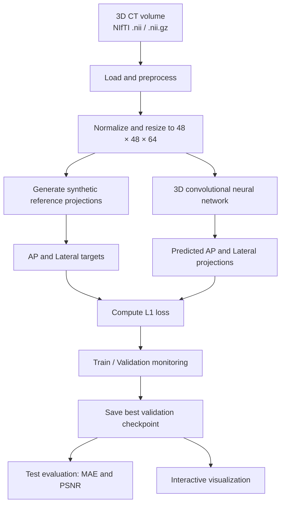
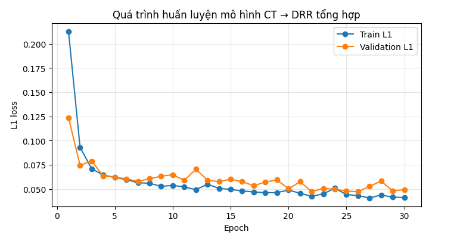

# CT to Synthetic X-ray (DRR) Generation

**3D CT Volume → Synthetic 2D Projections · Deep Learning · PyTorch · Google Colab**


> [!IMPORTANT]
> Đây là dự án thử nghiệm phục vụ học tập và nghiên cứu xử lý ảnh y tế. Mô hình được huấn luyện để xấp xỉ **ảnh chiếu tham chiếu tổng hợp từ CT**, không được huấn luyện bằng các cặp CT–X-quang lâm sàng. Kết quả không phải ảnh X-quang lâm sàng và **không được sử dụng để chẩn đoán hoặc đưa ra quyết định điều trị**.

## 1. Project Overview

Dự án khảo sát cách sử dụng mạng nơ-ron 3D để dự đoán hai ảnh chiếu 2D từ một thể tích chụp cắt lớp vi tính (CT). Toàn bộ quy trình được triển khai trong notebook Google Colab, bao gồm chuẩn bị dữ liệu, tạo ảnh tham chiếu, huấn luyện, đánh giá và trực quan hóa kết quả.

Mục tiêu kỹ thuật là xây dựng một quy trình thử nghiệm có thể tái chạy và theo dõi được: từ dữ liệu CT 3D đến ảnh chiếu tổng hợp theo hai hướng **AP** và **Lateral**.

### Pipeline



## 2. Project Goals

- Đọc các thể tích CT 3D ở định dạng NIfTI.
- Chuẩn hóa dữ liệu CT về kích thước đầu vào cố định để phù hợp với tài nguyên Google Colab.
- Tạo ảnh chiếu tham chiếu AP và Lateral từ thể tích CT đã chuẩn hóa.
- Huấn luyện mạng nơ-ron 3D để xấp xỉ các ảnh tham chiếu tổng hợp.
- Theo dõi Train L1 và Validation L1, đồng thời lưu checkpoint có Validation L1 thấp nhất.
- Đánh giá dự đoán bằng MAE và PSNR trên tập kiểm tra.
- Cho phép chọn ca CT, vùng thể tích, mặt phẳng và lát cắt để xem kết quả trực quan.

## 3. Methodology

### 3.1. Data preprocessing

1. Đọc thể tích CT 3D từ file `.nii` hoặc `.nii.gz` bằng NiBabel.
2. Chuyển hướng thể tích theo quy ước RAS (Right, Anterior, Superior).
3. Lấy mẫu và nội suy thể tích về kích thước `48 × 48 × 64`.
4. Chuẩn hóa cường độ CT bằng cửa sổ đơn giản dựa trên khoảng `-1000 HU` đến `1500 HU`, sau đó đưa giá trị về khoảng `[0, 1]`.
5. Tạo và lưu bộ nhớ đệm tiền xử lý để tránh xử lý lại các ca đã chuẩn bị.

### 3.2. Synthetic reference projections

Notebook tạo hai ảnh tham chiếu bằng phép chiếu trung bình từ thể tích CT chuẩn hóa:

- **AP:** lấy trung bình theo trục trước–sau.
- **Lateral:** lấy trung bình theo trục trái–phải.

Đây là mục tiêu giả lập được tạo bằng phép tính trên dữ liệu CT. Quy trình hiện tại không mô phỏng đầy đủ vật lý chụp X-quang, đáp ứng của đầu dò, phổ tia, tán xạ hoặc các yếu tố của hệ thống chụp thực tế.

### 3.3. Model architecture

Mô hình `CTToSyntheticXrayNet` gồm:

- **3D encoder:** các lớp tích chập 3D, Instance Normalization và LeakyReLU để trích xuất đặc trưng thể tích.
- **Projection operation:** tổng hợp đặc trưng theo hai trục để hình thành đặc trưng chiếu AP và Lateral.
- **Two 2D heads:** hai nhánh tích chập 2D riêng biệt để dự đoán ảnh AP và ảnh Lateral.
- **Output:** hai ảnh xám có kích thước `48 × 64`, với giá trị đầu ra được giới hạn bằng hàm Sigmoid.

### 3.4. Training setup

| Parameter | Default setting |
|---|---|
| Input format | 3D NIfTI (`.nii`, `.nii.gz`) |
| Preprocessed volume | `48 × 48 × 64` |
| Maximum CT cases | `40` |
| Train / validation / test | Xấp xỉ `70% / 15% / 15%` |
| Batch size | `1` |
| Epochs | `30` |
| Loss function | L1 Loss |
| Optimizer | AdamW |
| Learning rate | `1e-3` |
| Weight decay | `1e-5` |
| Random seed | `42` |
| Checkpoint selection | Lowest Validation L1 |

Đây là cấu hình mặc định trong notebook và có thể được điều chỉnh trong phần mã tương ứng. Số ca thực tế có thể thấp hơn giới hạn nếu dữ liệu thiếu hoặc một số thể tích không hợp lệ.

## 4. Technology Stack

| Component | Technology |
|---|---|
| Programming language | Python |
| Deep learning | PyTorch |
| Medical volume I/O | NiBabel / NIfTI |
| Numerical processing | NumPy |
| Visualization | Matplotlib |
| Progress display | tqdm |
| Interactive controls | ipywidgets |
| Runtime | Google Colab |
| Dataset | TotalSegmentator small dataset |
| Evaluation | MAE, PSNR, L1 loss |

## 5. Repository Structure

```text
ct-to-synthetic-xray/
├── README.md
├── LICENSE
├── .gitignore
├── requirements.txt
├── notebooks/
│   └── CT_to_Synthetic_Xray_Training_Colab.ipynb
├── results/
│   ├── training_curve.png
│   ├── test_metrics.json
│   └── training_history.json
└── models/
    └── best_model.pt
```

> [!NOTE]
> Đây là cấu trúc đề xuất cho repository GitHub. Chỉ thêm các tệp sau khi chúng thực sự được tạo và tải lên. Dataset, cache tiền xử lý và các file ZIP lớn không nên được commit vào repository.

## 6. Dataset

Dự án sử dụng các thể tích CT từ **TotalSegmentator small dataset**.

- Dataset reference: [TotalSegmentator small dataset — Zenodo](https://zenodo.org/records/8367170)
- Archive được notebook sử dụng: `Totalsegmentator_dataset_small_v2.zip`
- Dung lượng quan sát trong phiên Colab: khoảng `3.0 GiB` (có thể thay đổi tùy bản tải).
- Định dạng CT được tìm kiếm: `ct.nii.gz` hoặc `ct.nii`.

Dataset không được đóng gói trong repository vì dung lượng lớn. Khi chạy notebook ở một phiên Colab mới, có thể cần tải lại dữ liệu và tạo lại cache. Người dùng cần tuân thủ điều khoản sử dụng của dataset gốc.

## 7. Getting Started

### 7.1. Run on Google Colab

Notebook được thiết kế để chạy trên Google Colab. GPU được khuyến nghị để giảm thời gian huấn luyện.

1. Mở notebook `notebooks/CT_to_Synthetic_Xray_Training_Colab.ipynb` trên GitHub.
2. Chọn **Open in Colab** nếu liên kết được hiển thị; nếu không, mở [Google Colab](https://colab.research.google.com/) và tải notebook từ GitHub.
3. Trong Colab, vào **Runtime → Change runtime type** và chọn GPU nếu có.
4. Chạy lần lượt các ô mã từ trên xuống dưới.
5. Chờ notebook tìm/tải dữ liệu, tiền xử lý, huấn luyện và đánh giá mô hình.
6. Xem biểu đồ loss, ảnh dự đoán và các chỉ số trên tập kiểm tra.
7. Tải gói mô hình hoặc các file kết quả cần giữ trước khi phiên Colab kết thúc.

### 7.2. Dependencies

Notebook tự cài các thư viện Python chính như `nibabel`, `matplotlib`, `tqdm`, `ipywidgets` và `requests`. PyTorch thường có sẵn trong môi trường Colab. Phiên bản thực tế phụ thuộc runtime được cấp.

File `requirements.txt` trong repository là danh sách tham khảo cho các thư viện cần thiết. Nếu chạy ngoài Colab, người dùng cần tự thiết lập phiên bản PyTorch phù hợp với CPU/GPU và môi trường Python của mình.

## 8. Outputs

Notebook lưu kết quả trong thư mục `outputs/trained_model/` dưới thư mục gốc `/content/ct_to_synthetic_xray/` của Colab.

| File | Description |
|---|---|
| `best_model.pt` | Checkpoint có Validation L1 thấp nhất, gồm trọng số và một số thông tin cấu hình |
| `training_history.json` | Train L1 và Validation L1 qua từng epoch |
| `training_curve.png` | Biểu đồ Train L1 và Validation L1 trong một lần huấn luyện |
| `test_metrics.json` | Các chỉ số đánh giá tổng hợp trên tập kiểm tra |
| `trained_model_bundle.zip` | Gói ZIP được tạo ở thư mục gốc để tải kết quả mô hình về máy |

`trained_model_bundle.zip` nằm tại `/content/ct_to_synthetic_xray/trained_model_bundle.zip`. Đường dẫn trên thuộc phiên Colab, không tự động đồng bộ với GitHub.

## 9. Evaluation

Notebook đánh giá mô hình trên tập kiểm tra bằng các chỉ số sau:

- **MAE (Mean Absolute Error):** sai số tuyệt đối trung bình giữa ảnh mô hình dự đoán và ảnh DRR tham chiếu.
- **PSNR (Peak Signal-to-Noise Ratio):** chỉ số dựa trên sai số bình phương giữa hai ảnh đã chuẩn hóa.
- **Train L1 / Validation L1:** theo dõi sai số trong quá trình huấn luyện và lựa chọn checkpoint.

Các giá trị thực nghiệm được ghi vào `test_metrics.json` và `training_history.json`. README không cố định số liệu đánh giá vì kết quả có thể thay đổi theo các ca CT hợp lệ, phiên bản thư viện, thiết bị tính toán và lần chạy. Hãy dùng số liệu thực tế từ các file JSON đã tạo để báo cáo kết quả.

**Cách diễn giải:** MAE/PSNR trong dự án này đo mức độ gần với ảnh tham chiếu tổng hợp được tạo từ CT. Chúng không đánh giá độ chính xác so với ảnh X-quang thật và không chứng minh giá trị chẩn đoán.

### 9.1. Training and Validation Loss

Biểu đồ dưới đây minh họa Train L1 và Validation L1 qua 30 epoch của một lần chạy. Đường màu xanh biểu diễn sai số trên tập huấn luyện; đường màu cam biểu diễn sai số trên tập kiểm định. Sai số giảm mạnh ở giai đoạn đầu và ổn định hơn ở các epoch sau, trong khi Validation L1 vẫn có dao động.



*Figure 1. Training and validation L1 loss across 30 epochs. The plot is an illustrative record from one training run; results may vary between runs and datasets.*

Đường loss chỉ phản ánh sai số so với ảnh tham chiếu tổng hợp trong thiết lập hiện tại. Cần kết hợp các chỉ số trên tập kiểm tra và so sánh trực quan ảnh dự đoán với ảnh tham chiếu để đánh giá mô hình; biểu đồ này không chứng minh chất lượng lâm sàng.

## 10. Interactive Visualization

Notebook cung cấp giao diện tương tác để:

- Chọn một ca CT từ danh sách.
- Chọn toàn bộ thể tích hoặc một vùng tương đối ở 1/3 dưới, giữa hoặc trên.
- Chọn mặt phẳng Axial, Coronal hoặc Sagittal.
- Chọn lát cắt cần xem.
- So sánh lát cắt CT với ảnh DRR tham chiếu và ảnh do mạng dự đoán.

Các vùng 1/3 trên/giữa/dưới được xác định theo chiều của thể tích đã chuẩn hóa, không bảo đảm tương ứng chính xác với một cơ quan giải phẫu.

## 11. Limitations

1. **Pseudo-targets:** mô hình học từ ảnh chiếu tham chiếu tự tạo, không phải từ cặp CT–X-quang thật.
2. **Simplified projection:** phép chiếu trung bình không thay thế mô phỏng vật lý của hệ thống chụp X-quang.
3. **Dataset scale:** cấu hình mặc định giới hạn tối đa 40 ca CT; quy mô này chỉ phù hợp cho một prototype học tập.
4. **Reduced resolution:** thể tích được đưa về `48 × 48 × 64`, có thể làm mất chi tiết so với dữ liệu gốc.
5. **Generalization:** cần đánh giá thêm trên nhiều ca độc lập và các nguồn dữ liệu khác trước khi đưa ra kết luận rộng hơn.
6. **MRI is not supported:** notebook hiện xử lý CT; MRI cần quy trình chuẩn hóa và dữ liệu riêng.
7. **No clinical validation:** mô hình chưa được xác nhận cho ứng dụng lâm sàng và không dùng cho chẩn đoán hoặc điều trị.

## 12. Reproducibility

Notebook đặt seed mặc định là `42` cho các bộ sinh số ngẫu nhiên của Python, NumPy và PyTorch. Để so sánh các lần chạy, nên ghi lại:

- Số lượng và danh sách ca CT được sử dụng.
- Phiên bản Python, PyTorch và các thư viện liên quan.
- Loại thiết bị thực thi (CPU/GPU).
- Cấu hình huấn luyện, seed và số epoch.
- Giá trị `best_val_loss` và các chỉ số trong `test_metrics.json`.

Do khác biệt về phần cứng, thư viện và thứ tự tính toán, kết quả có thể không giống hoàn toàn giữa các môi trường.

## 13. Future Work

- Tăng số lượng ca CT và đánh giá trên các tập kiểm tra độc lập.
- Bổ sung ảnh minh họa đầu vào, ảnh tham chiếu và ảnh dự đoán vào phần kết quả.
- Nghiên cứu phương pháp tạo DRR gần với mô hình vật lý chụp X-quang hơn.
- So sánh kiến trúc mạng và chiến lược huấn luyện khác nhau.
- Cải thiện tài liệu về môi trường, dữ liệu và cách tái lập thí nghiệm.

## 14. License and Data Usage

Hãy bổ sung file `LICENSE` ở thư mục gốc sau khi xác nhận quyền công bố mã nguồn và lựa chọn giấy phép phù hợp. Giấy phép của repository không tự động áp dụng cho dataset bên ngoài; việc tải và sử dụng dữ liệu phải tuân theo điều khoản của nguồn dữ liệu gốc.

## 15. Project Status

**Status: Research Prototype — Educational Use**

Các thành phần chính của notebook:

- CT loading and preprocessing.
- Synthetic AP/Lateral target generation.
- 3D convolutional neural network.
- Training and validation loop.
- Best-checkpoint saving.
- Test evaluation using MAE and PSNR.
- Interactive CT slice and projection visualization.
- Export of model checkpoint and evaluation files.

---

*This project is intended for educational and research purposes only. It is not a clinically validated medical imaging system.*
